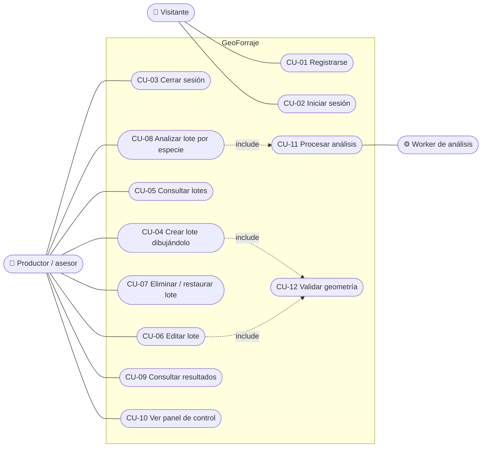
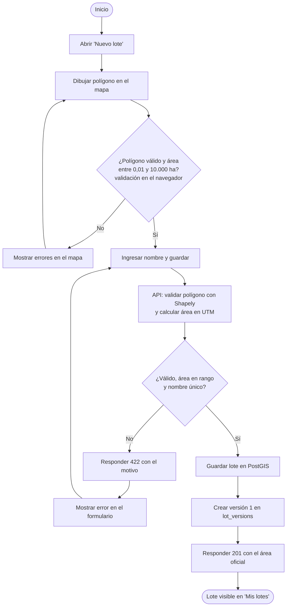
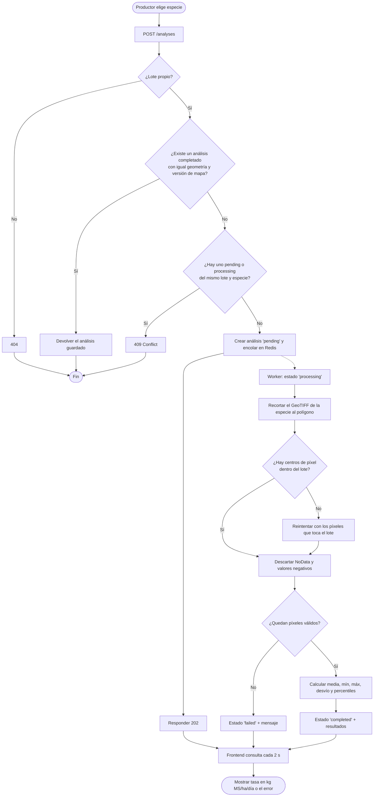
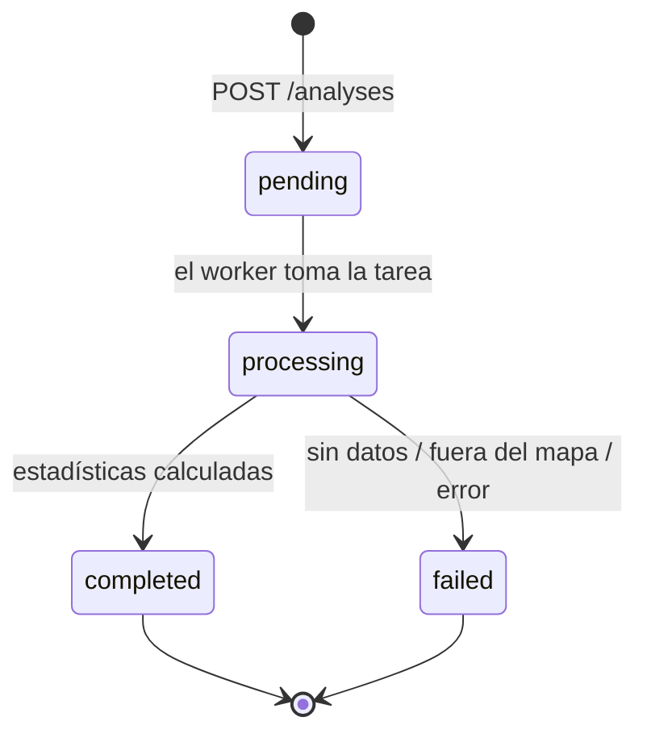
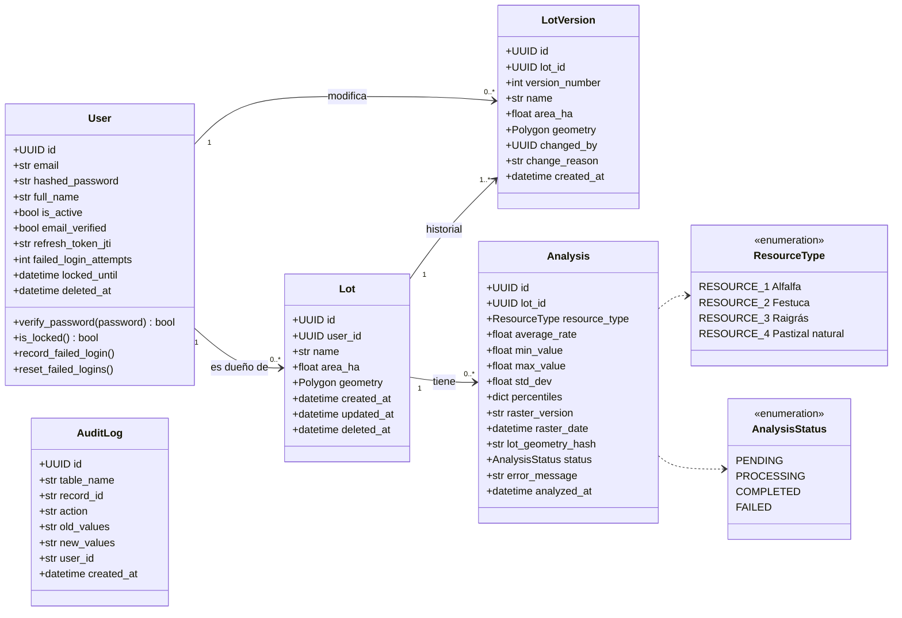
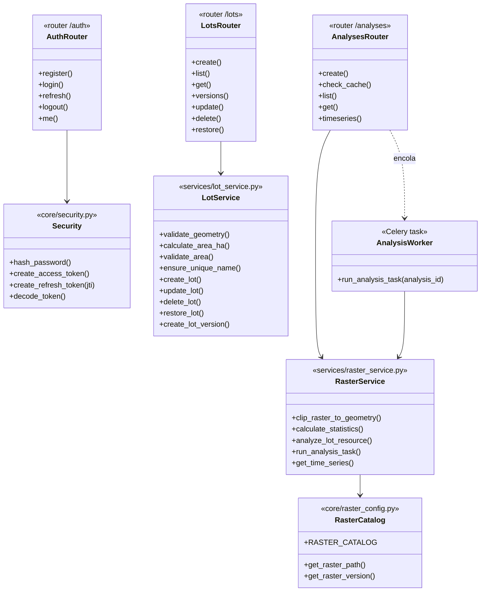

# Análisis y Diseño - GeoForraje 1.0

Artefactos de análisis y diseño del sistema: casos de uso, diagramas de actividades, diagrama de estados del análisis y diagrama de clases. Los diagramas están en Mermaid y GitHub los muestra dibujados. Complementa [`requerimientos.md`](requerimientos.md), [`negocio.md`](negocio.md), [`arquitectura.md`](arquitectura.md) y [`diagrama_er.md`](diagrama_er.md).

## 1. Actores

| Actor | Descripción |
|-------|-------------|
| **Visitante** | Persona sin sesión iniciada: puede registrarse o iniciar sesión |
| **Productor / asesor** (usuario registrado) | Gestiona sus lotes y pide análisis de crecimiento de pasturas |
| **Worker de análisis** (actor de sistema) | Proceso Celery que calcula los análisis en segundo plano |

## 2. Diagrama de casos de uso

## 3. Especificación de casos de uso

| ID | Caso de uso | Actor | Flujo principal | Flujos alternativos | Reglas |
|----|-------------|-------|-----------------|---------------------|--------|
| **CU-01** | Registrarse | Visitante | 1. Completa nombre, email y contraseña. 2. El sistema crea la cuenta. 3. Inicia sesión automáticamente | Email ya registrado → 400. Contraseña de menos de 8 caracteres → error de validación | RN-AUTH-01 |
| **CU-02** | Iniciar sesión | Visitante | 1. Ingresa email y contraseña. 2. Recibe access y refresh token. 3. Entra al panel de control | Credenciales inválidas → 401. 5 fallos → cuenta bloqueada 15 min (423). Muchos intentos por IP → 429 | RN-AUTH-02, RN-AUTH-05, RN-AUTH-07 |
| **CU-03** | Cerrar sesión | Productor | 1. Toca "Cerrar sesión". 2. El servidor invalida el refresh token. 3. El cliente borra los tokens y va a `/login` | Sin conexión: igual se cierra la sesión local | RN-AUTH-06 |
| **CU-04** | Crear lote | Productor | 1. Abre "Nuevo lote". 2. Dibuja el polígono o rectángulo en el mapa. 3. Ve el área aproximada. 4. Pone un nombre y guarda. 5. El sistema valida, calcula el área oficial y crea la versión 1 | Polígono inválido o área fuera de rango → 422. Nombre repetido → 422 | RN-GEO-01 a 07, RN-LOT-02, RN-LOT-03 |
| **CU-05** | Consultar lotes | Productor | 1. Abre "Mis lotes". 2. Filtra por nombre, fecha, área o zona. 3. Abre el detalle con el mapa y el historial de versiones | Sin lotes → invitación a crear uno | RN-LOT-01 |
| **CU-06** | Editar lote | Productor | 1. Cambia el nombre y/o redibuja el polígono. 2. Indica un motivo. 3. El sistema guarda y, si cambió la geometría, agrega una versión | Mismas validaciones que CU-04 | RN-LOT-03 |
| **CU-07** | Eliminar / restaurar lote | Productor | 1. Elimina el lote (se marca como eliminado). 2. Lo ve tildando "Mostrar lotes eliminados" en el listado y puede restaurarlo | — | RN-LOT-04, RN-LOT-05 |
| **CU-08** | Analizar lote por especie | Productor | 1. En el lote elige una especie (alfalfa, festuca, raigrás o pastizal). 2. El sistema crea el análisis en estado pendiente y lo encola. 3. La pantalla se actualiza sola hasta que termina | Ya existe el mismo análisis → se devuelve el guardado. Hay uno en curso → 409 | RN-ANA-01, RN-ANA-07, RN-ANA-08 |
| **CU-09** | Consultar resultados | Productor | 1. Ve el historial de análisis del lote. 2. Abre uno: tasa promedio, mínimo, máximo, desvío y percentiles | Análisis fallido → se muestra el motivo | RN-ANA-02, RN-ANA-06 |
| **CU-10** | Ver panel de control | Productor | Ve lotes activos, superficie total, cantidad de análisis y los últimos resultados | — | — |
| **CU-11** | Procesar análisis | Worker | 1. Toma la tarea. 2. Pasa el análisis a `processing`. 3. Recorta el mapa de la especie al lote. 4. Calcula las estadísticas. 5. Guarda `completed` | Lote fuera del mapa o sin datos → `failed` con mensaje | RN-ANA-02 a 06 |
| **CU-12** | Validar geometría | Sistema | Verifica tipo, validez, orientación, área y nombre | Cualquier falla → 422 con el motivo | RN-GEO-01 a 06 |

## 4. Diagrama de actividades: crear un lote (CU-04)

## 5. Diagrama de actividades: analizar un lote (CU-08 + CU-11)

## 6. Diagrama de estados del análisis

## 7. Diagrama de clases (modelo de dominio)

`AuditLog` está en el modelo pero todavía no se escribe (RN-AUD-03).

## 8. Diagrama de clases (servicios del backend)

