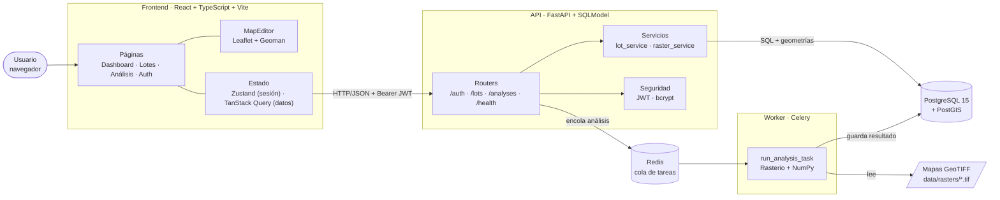
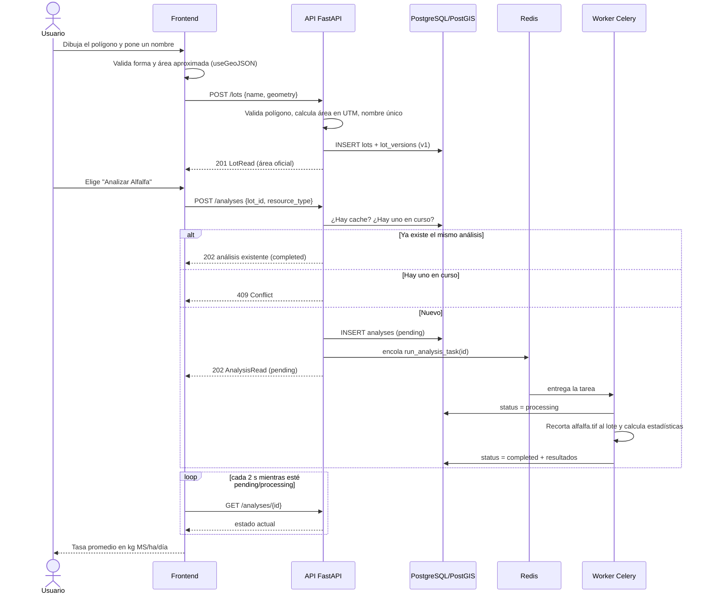
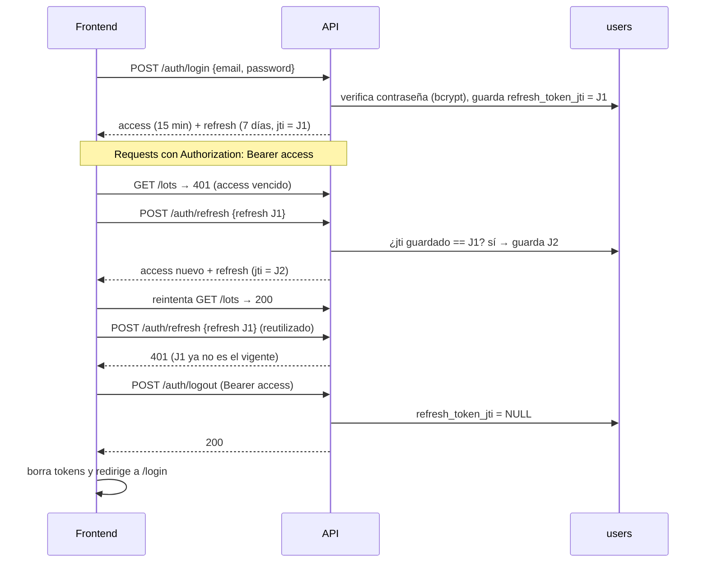
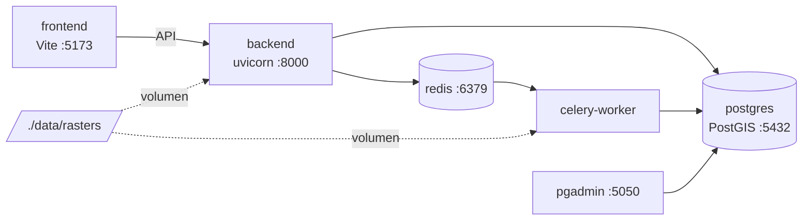

# Arquitectura del Sistema - GeoForraje 1.0

GeoForraje es una aplicación web cliente-servidor. El frontend (React) permite dibujar lotes sobre un mapa; la API (FastAPI) valida y guarda las geometrías en PostgreSQL/PostGIS; y un worker (Celery) recorta los mapas de crecimiento de pasturas al polígono de cada lote para calcular su tasa promedio.

## 1. Componentes

| Componente | Responsabilidad |
|------------|-----------------|
| **Frontend** | Interfaz: registro e inicio de sesión, dibujo y gestión de lotes, pedido y visualización de análisis, panel de control |
| **API** | Reglas de negocio, validación de geometrías, autenticación y autorización, persistencia; encola los análisis |
| **Worker Celery** | Procesa cada análisis fuera del request: recorta el raster al lote y calcula las estadísticas |
| **PostgreSQL + PostGIS** | Guarda usuarios, lotes (con su polígono), versiones y análisis; índice espacial para filtrar por zona |
| **Redis** | Cola de mensajes entre la API y el worker |
| **Mapas GeoTIFF** | Tasa de crecimiento (kg MS/ha/día) de 4 especies, derivados de MODIS (píxel ≈ 11 ha), 31/10/2026 |

## 2. Flujo principal: crear un lote y analizarlo

## 3. Autenticación: login, rotación y logout

El refresh token se invalida en el servidor guardando solo el identificador (`jti`) del vigente en `users.refresh_token_jti`. No se guarda el token en sí. Ver reglas RN-AUTH-03 a RN-AUTH-06 en [`negocio.md`](negocio.md).

## 4. Despliegue

### Desarrollo (`docker compose up -d --build`)

### Producción (`docker-compose.prod.yml`)

Nginx sirve el frontend compilado y hace de proxy hacia la API (Gunicorn + Uvicorn workers), con PostgreSQL/PostGIS, Redis, worker y beat de Celery, Prometheus y Grafana. Todavía no se desplegó en un servidor público.

## 5. Decisiones de arquitectura

| Decisión | Por qué |
|----------|---------|
| **FastAPI + SQLModel** | API asíncrona, validación con Pydantic y documentación Swagger automática; SQLModel une modelos de BD y esquemas |
| **PostgreSQL + PostGIS** | Estándar para datos geoespaciales: tipo `geometry`, índices espaciales y funciones como intersección por bounding box |
| **Shapely + pyproj** | Validar polígonos y calcular el área real proyectando a la zona UTM del lote |
| **Rasterio + NumPy** | Recortar un GeoTIFF por polígono y calcular estadísticas sin cargar el mapa entero |
| **Celery + Redis** | El análisis no bloquea la API; permite control de concurrencia y reintentos |
| **JWT con rotación de refresh token** | Sesión sin estado para el access token; el `jti` guardado permite invalidar el refresh token (rotación y logout) |
| **Eliminación lógica** | Conserva el historial de lotes y análisis y permite restaurar |
| **React + Vite + TanStack Query** | Interfaz rápida de desarrollar; TanStack Query maneja cache y *polling* del estado de los análisis |
| **Leaflet + Geoman** | Mapas sin costo de licencia; Geoman da herramientas de dibujo y edición de polígonos |
| **Mapas MODIS por especie** | Cobertura provincial de tasa de crecimiento ya procesada; un archivo por especie |
| **Docker Compose** | El mismo entorno en todas las máquinas del equipo |

## 6. Limitaciones conocidas

- Los mapas son de una sola fecha (31/10/2026); la serie temporal crecerá cuando se carguen mapas de otras fechas.
- Los emails de verificación y recuperación se registran en el log, no se envían.
- El límite de intentos de login por IP se guarda en memoria: se reinicia con el backend y no se comparte entre instancias.
- Las migraciones de Alembic están desactualizadas; en desarrollo las tablas se crean desde los modelos.
