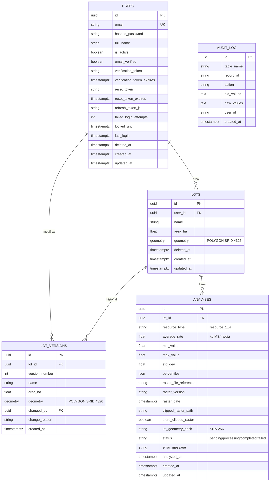

# Diagrama Entidad-Relación - GeoForraje 1.0

## Esquema de Base de Datos (PostgreSQL + PostGIS)

Fuente de verdad: los modelos SQLModel en `backend/app/models/`. En desarrollo las tablas se crean desde esos modelos al iniciar el backend (`AUTO_CREATE_TABLES=true`).



## Tablas y Descripción

### 1. `users` (seguridad)
- **Propósito**: credenciales y datos del usuario autenticado.
- **Relación**: uno a muchos con `lots`.
- **Campos clave**:
  - `id` (UUID), `email` (único, para login) y `hashed_password` (bcrypt).
  - `is_active` y `deleted_at` (baja lógica).
  - Verificación de email: `email_verified` y `verification_token`.
  - Recuperación de contraseña: `reset_token`.
  - `refresh_token_jti`: identificador del único refresh token válido (rotación).
  - Bloqueo por intentos fallidos: `failed_login_attempts` y `locked_until`.

### 2. `lots` (gestión de lotes)
- **Propósito**: lotes georreferenciados dibujados sobre el mapa.
- **Propiedad**: cada lote pertenece a un usuario (`user_id` FK).
- **Campos clave**:
  - `name`: único por usuario entre sus lotes activos.
  - `area_ha`: calculada en el servidor proyectando a UTM.
  - `geometry`: PostGIS POLYGON en SRID 4326, con índice espacial GIST.
  - `deleted_at`: borrado lógico. Un lote eliminado se puede restaurar y sus análisis se conservan.
- **Validaciones**: polígono válido, orientación CCW, área entre 0,01 y 10.000 ha.

### 3. `lot_versions` (historial de geometrías)
- **Propósito**: trazabilidad de los cambios de geometría de cada lote.
- **Relación**: muchos a uno con `lots`.
- **Reglas**: la versión 1 se crea al dar de alta el lote. Cada cambio de geometría agrega una versión con `change_reason`; los cambios de nombre no generan versión.

### 4. `analyses` (análisis forrajero)
- **Propósito**: resultados del análisis raster de un lote para una especie forrajera.
- **Relación**: muchos a uno con `lots`.
- **Especies** (`resource_type`):

  | ID | Especie |
  |----|---------|
  | `resource_1` | Alfalfa |
  | `resource_2` | Festuca |
  | `resource_3` | Raigrás |
  | `resource_4` | Pastizal natural |

- **Campos clave**:
  - Resultados: `average_rate` (tasa de crecimiento promedio en kg MS/ha/día), mínimo, máximo, desvío y `percentiles` (p25 a p95).
  - Flujo: `status` (pending → processing → completed/failed).
  - Raster usado: `raster_version` y `raster_date`, base para la futura serie temporal.
  - Cache: `lot_geometry_hash`. Si ya existe un análisis completado con la misma geometría, especie y versión de raster, se reutiliza.

### 5. `audit_log` (auditoría, preparado)
- Tabla preparada para registrar cambios. Todavía no se escribe desde la aplicación.

## Índices y Performance

```sql
-- Índices espaciales (los crea GeoAlchemy2 automáticamente)
CREATE INDEX ON lots USING GIST (geometry);
CREATE INDEX ON lot_versions USING GIST (geometry);
-- Lotes por usuario
CREATE INDEX ix_lots_user_id ON lots (user_id);
-- Login y tokens
CREATE UNIQUE INDEX ix_users_email ON users (email);
CREATE INDEX ix_users_verification_token ON users (verification_token);
CREATE INDEX ix_users_reset_token ON users (reset_token);
-- Análisis: concurrencia, cache y versión de raster
CREATE INDEX idx_analyses_lot_resource_status ON analyses (lot_id, resource_type, status);
CREATE INDEX idx_analyses_geometry_hash ON analyses (lot_geometry_hash);
CREATE INDEX idx_analyses_raster_version ON analyses (raster_version);
```

## Relaciones Clave

| De | Para | Tipo | Descripción |
|----|------|------|-------------|
| users.id | lots.user_id | 1:N | Un usuario puede tener varios lotes |
| lots.id | lot_versions.lot_id | 1:N | Historial de geometrías de un lote |
| users.id | lot_versions.changed_by | 1:N | Quién hizo cada cambio |
| lots.id | analyses.lot_id | 1:N | Un lote puede tener varios análisis |
| users.id | JWT `sub` | — | El token JWT contiene el id del usuario |
